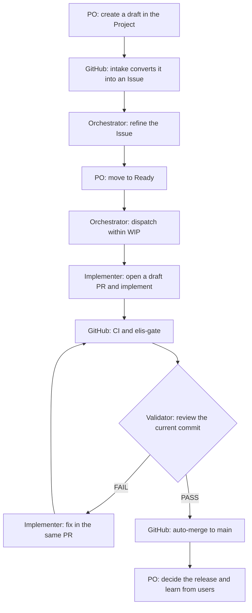

# ELIS — Lean Development and Management Flow v1.1

23 November 2026 · Carlos Rocha

> This is the authoritative version. A Brazilian Portuguese translation is kept in [`docs/pt-BR/process.md`](pt-BR/process.md).

## 1. What changes in v1.1

Version 1.1 keeps the rules of v1.0 and replaces controls that relied on discipline with controls that GitHub enforces.

| Topic | v1.0 | v1.1 |
| --- | --- | --- |
| Identities | Segregation "where possible" | One GitHub App per agent, with permissions by role |
| Validator PASS | A comment, or a check to be defined | A native review by the Validator's App, read by the required check `elis-gate` |
| Risk class | Declared in the PR | Computed from the changed paths; agents can only raise it |
| Merge | The Orchestrator goes through a checklist | Auto-merge: GitHub merges when the gates pass |
| WIP limit | Absent | 1 Issue per Implementer, 3 PRs in `Review`, 5 items in `Ready` |
| PO management | Project as an overview | Project as the PO's only working screen |
| New projects | Manual set-up | Model repository and bootstrap script |
| Language | Not defined | UK English; pt-BR optional in bilingual projects |
| Hotfix | "Minimum checks" | Same gates; revert through a PR first |
| No bypass | Absolute | Audited exception, by the PO only |

### Adopted from the "deterministic Kanban" proposal (Gemini)

The proposal was reviewed on 23 November 2026. Seven points are part of this version and one is left out; section 12 details the extension for research.

| Point of the proposal | Decision | Where it is |
| --- | --- | --- |
| Board state comes from technical triggers, not manual updates | Already the basis of v1.1 | Sections 7 and 8 |
| Draft PR opened when work starts | Adopted | Rule 4, sections 7 and 8 |
| "Ready for review" as the trigger for expensive steps | Adopted | Section 7 |
| Issue forms, with blank Issues disabled | Adopted | Section 6 |
| Reproducibility fields and a regression test per anomaly | Adopted in research repositories | Section 12 |
| Evaluation report in a single comment, with traces as artefacts | Adopted in research repositories | Sections 7 and 12 |
| Recording negative results | Adopted | Rule 13, section 10 |
| WIP limit enforced by failing a check on the PR | Not adopted | Section 12 |

### Decisions for the PO to confirm

- [ ] **GitHub organisation:** repositories and the Project live under an organisation. This is what allows a GitHub App to access the Project.
- [ ] **Plan:** in private repositories, the ruleset is only enforced on a paid plan (Team, in an organisation). Apps do not take up a licence.
- [ ] **Where the agents run:** on GitHub Actions runners or on your own machine, through a self-hosted runner. Section 7 assumes Actions runners.
- [ ] **WIP limits:** the values 1, 3 and 5 are a starting point, to be tuned with use.

The Issue forms, the PR template and the `eval` workflow are already in the model folder. The other files are specified here and have not been created yet. Nothing has been tested in a repository. The GitHub behaviours cited come from knowledge of the documentation and have not yet been checked in a repository. Step 8 of section 11 confirms both points before adoption.

## 2. Core rules (`AGENTS.md`)

These thirteen rules are all an agent loads in each session. The text below is the `AGENTS.md` of the model repository.

```markdown
# Agent rules

1. Every change to `main` goes through a pull request. No direct pushes, no force pushes, no bypass, by anyone.
2. Write everything in UK English: code, comments, commits, branches, Issues, PRs and reviews.
3. Work only on Issues in `Ready`. One Issue per Implementer at a time.
4. One Issue, one branch, one PR. Branch from an up-to-date `main` (`feat/123-short-summary`) and open a draft PR straight away.
5. Keep PRs small. Fix failures in the same branch and the same PR.
6. Act only under your own GitHub App identity. Never use another agent's credentials.
7. Implementers never review. Validators never push code. Nobody validates their own work.
8. A Validator starts from a fresh session, reads the Issue and the diff, and runs the tests itself.
9. A PASS covers one commit. New commits need a new PASS.
10. Never weaken a check, lower a risk class or edit `.github/` to get a PR through.
11. Product questions go to the PO: add `needs-po`, state the question and the options, then move to the next item.
12. No secrets or real personal data in the repository, in logs or in PR text.
13. Record negative results. An experiment that refutes its hypothesis is documented, never silently dropped.
```

The rest of this document explains how GitHub enforces each rule. Agents do not need to read it in every session.

## 3. Language

All versioned content and every record on GitHub is written in UK English. Brazilian Portuguese is added as a translation, never as the original.

| Content | Rule |
| --- | --- |
| Code, comments, commits, branches | UK English, always |
| Issues, PRs, reviews, labels, Project fields | UK English, always |
| Documentation | Original in `docs/`; optional translation in `docs/pt-BR/`, with the same file name |
| README | `README.md` in English; `README.pt-BR.md` in bilingual projects |
| Product text | Translation files for `en-GB` and `pt-BR`; no hard-coded text |
| PO drafts in the Project | Any language; the Orchestrator writes the Issue in UK English and keeps the original as a quotation |

- **Bilingual project:** one that has the folder `docs/pt-BR/`. CI checks that every translation has an English original.
- **Divergence:** the English original prevails. A PR that changes a translated document updates the translation in the same PR.
- **Spelling:** British, as in `organise`, `behaviour`, `colour` and `licence`. Dates as `23 November 2026` or `2026-11-23`.
- **Verification:** `cspell` with the `en-GB` dictionary runs in CI over documentation, comments and the PR title.

## 4. Agent naming

Each agent has a unique identifier in the format `{project}-{role}-{nn}`, for example `elis-imp-01`.

| Part | Rule | Values |
| --- | --- | --- |
| `project` | Product code, 2 to 4 lower-case letters | `elis` = ELIS |
| `role` | Role, 3 letters | `orc` Orchestrator (PM), `imp` Implementer, `val` Validator |
| `nn` | Two-digit sequence per role | `01`, `02`, … |

The PO is human and stays outside the notation: the PO acts with a personal GitHub account. ELIS starts with `elis-orc-01`, `elis-imp-01`, `elis-imp-02` and `elis-val-01`.

The same identifier appears everywhere:

| Where | Form |
| --- | --- |
| GitHub App | Name `elis-imp-01`; commits, PRs and reviews appear as `elis-imp-01[bot]` |
| Registry in the repository | Entry in `.github/agents.yml` |
| Local worktree | Folder `elis-imp-01` |
| Agent session | `elis-imp-01 · #123` |
| Project | Text field `Agent`, filled in by the Orchestrator |

GitHub App names are unique across the whole of GitHub. If `elis-imp-01` is taken, the App receives the organisation's prefix; the agent identifier does not change.

```yaml
# .github/agents.yml
agents:
  - id: elis-orc-01
    role: orchestrator
    app: elis-orc-01
  - id: elis-imp-01
    role: implementer
    app: elis-imp-01
  - id: elis-imp-02
    role: implementer
    app: elis-imp-02
  - id: elis-val-01
    role: validator
    app: elis-val-01
```

## 5. Identities: one GitHub App per agent

Each agent acts through its own GitHub App, with the permissions of its role. The separation between implementing, validating and merging is then enforced by GitHub.

| Repository permission | `orc` | `imp` | `val` |
| --- | --- | --- | --- |
| Contents | write (merge) | write (branches) | read |
| Pull requests | write | write | write (reviews) |
| Issues | write | write | write |
| Actions and Checks | read | read | read |
| Workflows | none | none | none |
| Administration | none | none | none |
| Organisation Projects | write | read | read |

What these permissions guarantee, whatever the agent does:

- The Validator cannot push code, because it only reads the contents.
- No agent changes workflows or protection rules.
- An App does not approve its own PR.
- Every commit, PR and review is attributed to an identifiable agent.

### How the PASS becomes unforgeable

The Validator records PASS or FAIL as a native PR review: "Approve" or "Request changes". The required check `elis-gate` accepts a PASS only when three conditions hold:

1. The author of the review is registered as a `validator` in the `agents.yml` on `main`.
2. The review refers to the current commit of the PR.
3. The author of the PR is registered as an `implementer`.

Changing `agents.yml` or `elis-gate` itself requires a PR in `.github/`. `CODEOWNERS` assigns that folder to the PO, and the ruleset requires the PO's approval.

### Ruleset for the `main` branch

- Pull request required, with zero general approvals and mandatory code owner review.
- Required checks: `ci` and `elis-gate`, with GitHub Actions as their source.
- Linear history, squash merge, conversations resolved.
- Force pushes and deletion blocked.
- Empty bypass list.
- An up-to-date branch is **not** required; section 9 explains why.

### Credentials

- Each App has a private key. The agent receives only an installation token, valid for one hour.
- The keys are kept as secrets of Actions environments: `agent-orc`, `agent-imp` and `agent-val`. The environments accept the `main` branch only.
- Jobs that use an App key never trigger on `pull_request`. They use `pull_request_target`, `workflow_run`, `issues` or `schedule`, which read the workflow from `main`.
- The code of the PR runs without access to the Validator's token. Otherwise a malicious PR could approve itself.

One limit remains: the PO's account administers the organisation and can change any rule. Section 10 treats that case as an audited exception.

## 6. Model repository

A repository named `elis-repo-model`, marked as a template in the organisation, holds everything a new project needs to start with the flow in place.

```text
elis-repo-model/
├─ AGENTS.md                     # the thirteen agent rules (section 2)
├─ README.md
├─ cspell.json                   # en-GB dictionary
├─ docs/
│  ├─ process.md                 # this document, in UK English
│  └─ pt-BR/                     # only in bilingual projects
├─ scripts/
│  └─ bootstrap.ps1              # applies what a template does not copy
└─ .github/
   ├─ CODEOWNERS                 # /.github/ owned by the PO
   ├─ agents.yml                 # agent registry (section 4)
   ├─ risk-paths.yml             # risk class by path (section 9)
   ├─ labels.yml                 # needs-po, needs-refinement, ready, blocked, risk:high
   ├─ PULL_REQUEST_TEMPLATE.md
   ├─ ISSUE_TEMPLATE/
   │  ├─ config.yml              # blank issues disabled
   │  ├─ task.yml
   │  ├─ bug.yml
   │  ├─ research-hypothesis.yml # research repositories only (section 12)
   │  └─ agent-anomaly.yml       # research repositories only (section 12)
   ├─ rulesets/
   │  └─ main.json               # ruleset for main (section 5)
   ├─ scripts/                   # elis-gate.mjs, project-intake.mjs (to be created)
   └─ workflows/                 # section 7; eval.yml exists, the others are to be created
```

### How to replicate it in a project

1. Create the repository with the "Use this template" button.
2. Run `scripts/bootstrap.ps1` with the repository and the product code. It applies the ruleset, creates labels and environments, enables auto-merge and links the repository to the Project.
3. Create the project's GitHub Apps following the notation, install them in the repository and store the keys in the environments.
4. Fill in `agents.yml`, `risk-paths.yml` and `CODEOWNERS`.
5. Prove the gates with a low-risk PR and a simulated FAIL.

The bootstrap exists because a template copies files only. Rulesets, labels, secrets, environments, App installations and links to the Project are not copied.

### How to keep the projects aligned

The logic of the workflows lives in the model, as reusable workflows. Each project has short callers only, pinned to a tag:

```yaml
# .github/workflows/ci.yml in each project
name: ci
on:
  pull_request:
  push:
    branches: [main]
jobs:
  ci:
    uses: <org>/elis-repo-model/.github/workflows/ci.reusable.yml@v1
```

A fix in the model reaches every project when the `v1` tag is moved. For that reason the model itself uses the same ruleset, with the PO as code owner.

## 7. GitHub Actions workflows

Ten workflows cover development, tests, compliance, agent dispatch and management. Five start on day one; the others, when there is a use for them.

| Workflow | Triggers on | What it does | Starts |
| --- | --- | --- | --- |
| `ci` | PR and push to `main` | Lint, type check, build, unit and integration tests, `cspell` en-GB and `gitleaks`. A final job named `ci` summarises the result. | Day 1 |
| `pr-compliance` | PR opened or edited | Checks the branch name, a Conventional Commits title, the linked Issue, the template sections and a registered author. Enables auto-merge with squash. | Day 1 |
| `elis-gate` | PR and review | Computes the risk from the paths and requires the Validator's PASS on the current commit. | Day 1 |
| `project-intake` | Every 15 minutes | Converts Project drafts into Issues and mirrors the `Ready` status as the label `ready`. | Day 1 |
| `project-sync` | Issue, PR and CI events | Moves the item: `In Progress` when the draft PR is opened, `Review` when the PR is marked "ready for review", `Blocked` with the label `blocked`. | Day 1 |
| `agent-dispatch` | Labels, reviews and CI results | Starts the right agent, under its own identity, within the WIP limit. | Week 2 |
| `po-digest` | Weekly and on demand | Publishes deliveries, blockers, `needs-po` items and the indicators of section 11. | Week 2 |
| `e2e` | High-risk PRs; every night on `main` | End-to-end functional tests, with evidence attached to the PR. | With the first critical flow |
| `eval` | PR "ready for review" with the label `research`; on demand | Runs the benchmark of the experiment, keeps a single comment with metrics against the baseline and stores the traces as artefacts. One run at a time. | In research repositories |
| `release` | Tag `v*` or manual | Publishes to the `production` environment after the PO's approval. | With the first pilot |

### `elis-gate`: the check that decides the merge

```yaml
name: elis-gate
on:
  pull_request:
    types: [opened, synchronize, reopened, labeled, unlabeled]
  pull_request_review:
    types: [submitted, dismissed]
permissions:
  contents: read
  pull-requests: read
jobs:
  elis-gate:
    runs-on: ubuntu-latest
    steps:
      - uses: actions/checkout@v4
        with:
          # rules come from main, never from the PR under review
          ref: ${{ github.event.pull_request.base.sha }}
      - run: node .github/scripts/elis-gate.mjs
        env:
          GH_TOKEN: ${{ github.token }}
          PR_NUMBER: ${{ github.event.pull_request.number }}
```

The script applies four rules, in this order:

1. The author of the PR is a registered `implementer`; otherwise it fails.
2. The risk class is the highest among the changed paths. The label `risk:high` raises it; nothing lowers it.
3. Low risk passes. Medium or high risk requires the most recent review by a registered `validator` to be "Approve" on the current commit.
4. High risk also requires the `e2e` check to be green on the same commit.

### `project-intake`: from draft to Issue

```yaml
name: project-intake
on:
  schedule:
    - cron: "*/15 * * * *"
  workflow_dispatch:
permissions: {}
jobs:
  intake:
    # runs in one repository only, so two projects never convert the same draft
    if: github.repository == vars.PORTFOLIO_REPO
    runs-on: ubuntu-latest
    environment: agent-orc
    steps:
      - uses: actions/checkout@v4
      - uses: actions/create-github-app-token@v2
        id: app
        with:
          app-id: ${{ vars.ORC_APP_ID }}
          private-key: ${{ secrets.ORC_PRIVATE_KEY }}
          owner: ${{ github.repository_owner }}
      - run: node .github/scripts/project-intake.mjs
        env:
          GH_TOKEN: ${{ steps.app.outputs.token }}
          PROJECT_NUMBER: ${{ vars.PROJECT_NUMBER }}
```

The script reads the Project through the GraphQL API. Each draft with the `Product` field filled in is converted into an Issue in that product's repository, with the label `needs-refinement`. The Project item is the same before and after, with no duplication. Drafts without a `Product` stay as they are and appear in the PO digest.

### `agent-dispatch`: who is started, and when

| Event | Agent | Task |
| --- | --- | --- |
| Issue receives `needs-refinement` | `orc` | Write the objective, the acceptance criteria and the risk |
| Issue receives `ready` | a free `imp` | Open the draft PR and implement |
| Medium- or high-risk PR marked "ready for review", with green CI | `val` | Validate the current commit |
| "Request changes" review or red CI | the `imp` who authored the PR | Fix in the same PR |

The workflow generates the token of the agent's App and starts the agent's session on the runner, for example with `anthropics/claude-code-action`. If the agents run on your own machine, the same workflow runs on a self-hosted runner. When WIP is at its limit, dispatch waits.

### Known limits

- GitHub Projects does not trigger workflows. The board is therefore read periodically, with a delay of up to 15 minutes.
- `GITHUB_TOKEN` cannot access Projects. The Project workflows use the token of the Orchestrator's App.
- A required check must be reported on every PR. For that reason `ci` and `elis-gate` never use path filters in their triggers.
- Steps that cost tokens or time (`e2e`, `eval` and the Validator) only start once the PR is out of draft.

## 8. Management through GitHub Projects

The PO works on a single screen, the Project. Issues, PRs and checks remain the source of truth, updated by automation.



The PO creates the draft, authorises with `Ready` and decides the release. A FAIL goes back to the Implementer in the same PR, and every new commit goes through CI and `elis-gate` again.

### Project set-up

A single Project in the organisation gathers all products, with four fields.

| Field | Values | Who changes it |
| --- | --- | --- |
| `Status` | `Backlog`, `Ready`, `In Progress`, `Review`, `Done`, `Blocked` | The PO up to `Ready`; automation afterwards |
| `Product` | One value per product, such as `ELIS` | PO |
| `Priority` | `Now`, `Next`, `Later` | PO |
| `Agent` | Identifier of the agent responsible | Orchestrator |

| View | Shows | Used for |
| --- | --- | --- |
| Decisions | Items with the label `needs-po` | Answering product questions |
| Backlog | `Backlog` and `Ready`, grouped by `Product`, sorted by `Priority` | Creating, prioritising and authorising |
| Board | All items by `Status` | Seeing progress and blockers |
| Done | Items completed in the last 14 days | Checking deliveries |

Built-in Project workflows to enable: add Issues and PRs from the repositories automatically, set `Done` on close or merge, and archive completed items. If the Project offers the built-in workflow "Pull request linked to issue", it replaces the part of `project-sync` that sets `In Progress`.

The column limits of the Board are switched on as a visual alert: 3 in `Review` and 5 in `Ready`. They block nothing; `agent-dispatch` is what enforces WIP.

### PO flow

1. **Capture.** In the Backlog view, type the title in the last row and confirm. A draft is created; set `Product` and `Priority`.
2. **Wait for the Issue.** Within 15 minutes the draft becomes an Issue in the product's repository, in the same item. The Orchestrator writes the objective, the acceptance criteria and the risk.
3. **Authorise.** Read the criteria in the item's side panel, adjust them if needed and change `Status` to `Ready`. That gesture is the authorisation to execute.
4. **Decide.** Open the Decisions view and answer in a comment on the Issue. The Orchestrator removes the label `needs-po`.
5. **Follow.** The Board shows progress. The weekly digest arrives as a comment on the pinned Issue `PO digest`.
6. **Reprioritise or discard.** Change `Priority`, or close the Issue as "not planned".

Two PO actions sit outside the Project: approving a PR that changes `.github/` and approving a release. Both arrive as GitHub notifications, with a direct link.

### PM (Orchestrator) flow

1. **Refine.** Fill in the template of every Issue labelled `needs-refinement` and split the large ones. A product question becomes `needs-po`.
2. **Mind the queue.** Warn the PO when `Ready` holds fewer than 2 or more than 5 items.
3. **Dispatch.** Take the `Ready` items by `Priority`, within WIP, and record the `Agent` field.
4. **Unblock.** Every `Blocked` item receives a reason and an owner in a comment.
5. **Merge.** Nothing manual: auto-merge integrates. The Orchestrator handles conflicts and repeated FAILs.
6. **Report.** The weekly digest comes from the `po-digest` workflow, with no manual report.

The Orchestrator never changes `Priority` and never moves an item from `Backlog` to `Ready`. Those two decisions belong to the PO.

### Fit with good practice

The flow "a task in the Project creates an Issue" follows good practice, with three adjustments already built in above.

- **What is aligned:** a draft is the Project's feature for capturing ideas. The conversion keeps the same item, and the Issue remains the single source of the work.
- **Adjustment 1, trigger:** the Project does not trigger Actions. The conversion runs on a schedule, not at the moment of creation.
- **Adjustment 2, access:** the automation needs the token of a GitHub App and a Project owned by an organisation.
- **Adjustment 3, content:** a draft has no template and no labels. The Orchestrator therefore refines the Issue before the PO authorises it.

There is a path with no automation: create the Issue directly from the Project, choosing the repository when adding the item. It costs one more click and has no delay. It serves as a fallback if `project-intake` fails.

## 9. Delivery, risk and gates

Risk is computed from the changed paths and defines the gates. The merge is automatic when all of them pass.

| Class | Paths (example) | Gates |
| --- | --- | --- |
| Low | `docs/**`, `**/*.md` | `ci` |
| Medium | Application code; the default for any path not listed | `ci` and the Validator's PASS on the current commit |
| High | Authentication, personal data, memory, ingestion, migrations, `.github/**` | `ci`, PASS and `e2e`; for `.github/**`, the PO's approval as well |

```yaml
# .github/risk-paths.yml (illustrative paths; adjust per repository)
high:
  - "**/auth/**"
  - "**/migrations/**"
  - "**/ingestion/**"
  - "**/memory/**"
  - ".github/**"
low:
  - "docs/**"
  - "**/*.md"
default: medium
```

- **Classification:** `elis-gate` uses the highest class among the files of the PR. Any agent raises it with the label `risk:high`; nobody lowers it.
- **Merge:** `pr-compliance` enables auto-merge with squash. GitHub merges when the required checks pass.
- **Out-of-date base:** the ruleset does not require an up-to-date branch, so that somebody else's merge does not invalidate the PASS. `ci` runs again on `main` after every merge.
- **Merge queue:** only if `main` breaks often because of PRs merged in parallel.

### Independence of the Validator

- A fresh session, without the Implementer's history or reasoning.
- It starts from the Issue and the diff, not from the PR description.
- It runs the tests and the acceptance criteria; it does not merely read the code.
- It records the evidence in the review: the commands run and the result observed.

The three decisions of v1.0 remain separate: technical acceptance by `elis-gate`, integration by auto-merge and release by the PO.

## 10. FAIL, hotfix and exceptions

No situation lowers the gates: what changes is the priority and who acts.

| Situation | Action | Who |
| --- | --- | --- |
| The Validator gives a FAIL | "Request changes" review with reproduction, expected versus observed, and severity. Fix in the same PR; the new commit needs a new PASS. | `val`, then the `imp` who authored the PR |
| Repeated FAIL without progress | Change the Implementer, split the Issue or escalate. There is no fixed limit of attempts. A change of author requires another Validator. | `orc` |
| Red CI on the PR | Fix it in the PR. Never disable the check. | the `imp` who authored the PR |
| `main` is red after a merge | Revert through a PR first; fix afterwards, in a new Issue. | `orc` starts an `imp` |
| Hotfix | Branch `hotfix/…`, same gates, top priority in the queue. | `orc` |
| Change of scope | Stop the ambiguous part, add `needs-po` and move to the next item. | Any agent |
| An experiment refutes its hypothesis | Record the result in the Issue and in the research documentation. Close the PR without merging, or merge the record only. | the `imp` who authored the PR; `val` confirms |
| A broken check or rule blocks everything | Audited exception. | PO |

### Audited exception

Only the PO changes the ruleset, and only when a faulty check or rule prevents every merge.

1. Open an Issue with the label `process-exception`, the reason and the rule changed.
2. Make the minimum change and merge the fix through a PR.
3. Restore the rule and record the restoration in the same Issue.

The weekly digest lists the exceptions opened and closed.

## 11. Roll-out and indicators

Adoption takes nine steps, and the flow only counts as adopted after the test in step 8.

1. Confirm the four decisions of section 1.
2. Create the organisation, if it does not exist yet, and the Project with its fields, views and built-in workflows.
3. Create `elis-repo-model` with the files of section 6 and protect it with its own ruleset.
4. Create and install the Apps `elis-orc-01`, `elis-imp-01`, `elis-imp-02` and `elis-val-01`; store the keys in the environments.
5. Apply the model to the ELIS repository: files through a PR, the rest through `bootstrap.ps1`. Before that, take an inventory of the 36 workflows the repository already has in `.github/workflows/` and decide, for each one, whether it is kept, replaced or retired.
6. Enable the five day-one workflows.
7. Create the model files that are still missing, listed in section 6.
8. Test four cases: a low-risk PR, a PR with a simulated FAIL, a PR that changes `.github/` and a draft in the Project. None may be merged improperly.
9. Enable `agent-dispatch` and `po-digest`.

### Indicators

`po-digest` computes five signals, with no manual report.

| Indicator | How it is measured |
| --- | --- |
| Cycle time | From `Ready` to merge |
| Rework | PRs with a FAIL, and the main cause |
| Quality | Reverts and incidents after a merge or a release |
| Waiting for the PO | Time an Issue spends with `needs-po` |
| Learning | MVP hypotheses tested and decisions taken with users |

Commits, PRs and closed tasks are not targets.

## 12. Extension for research repositories (ELIS)

Research repositories use the same flow, with four additions taken from the "deterministic Kanban" proposal.

### What is added

| Addition | How it works |
| --- | --- |
| `research-hypothesis` form | Requires a hypothesis, the dataset and split, a metric with a baseline and a stopping rule before the Issue goes to `Ready` |
| `agent-anomaly` form | Requires the sample, the prompt version, the model and the seed; the fix includes a regression test |
| `eval` workflow | Runs the benchmark when the PR leaves draft; publishes the metrics in a single comment and keeps the traces for 30 days |
| Negative results | A refuted hypothesis is recorded and the PR is closed; the learning counts as a delivery |

Rules for `eval`:

- **Only what is reproducible is required.** Regression tests that call no LLM go into `ci`. A benchmark that calls an LLM varies between runs, even with a seed; it therefore informs, with thresholds and tolerance, and is not a required check.
- **One evaluation at a time.** The workflow uses `concurrency` to queue runs. This is the WIP limit of 1 from the proposal, enforced by Actions itself.
- **Protected secrets.** The LLM keys are kept in the `eval` environment of Actions; the job does not run code from a PR that comes from a fork.
- **Reuse.** The benchmark command comes from each repository's `EVAL_COMMAND` variable and writes `eval_metrics.json`. In ELIS, it points to what already exists in `benchmarks/`.
- **Thresholds.** Each metric may carry a threshold in `eval_metrics.json`. The job fails when a metric falls outside it.

### Board states

The six states of section 8 stay. The two extra columns of the proposal are not added:

- **Design & Spec:** this is the refinement of the Issue, done in `Backlog` with the label `needs-refinement`.
- **Documentation:** recording the findings is an acceptance criterion of the PR itself. A column after the checks and before the merge has no trigger to move it.

### What was not adopted

| Point of the proposal | Reason |
| --- | --- |
| `wip-guard` failing the PR when the column is full | It blocks finished work, which increases WIP. The check does not re-evaluate itself when the slot frees up. The limit sits at the entry, in `agent-dispatch` |
| Personal token `PROJECT_PAT` | A broad credential tied to one person. Access to the Project uses the Orchestrator's App |
| LLM benchmark as a required check | The result is not deterministic and is paid for on every commit |
| Metrics table and checklist filled in by hand in the PR | They duplicate the `eval` comment and what CI already verifies |
| Branch protection without identities or independent validation | v1.1 already covers this with the ruleset, the Apps and `elis-gate` |
