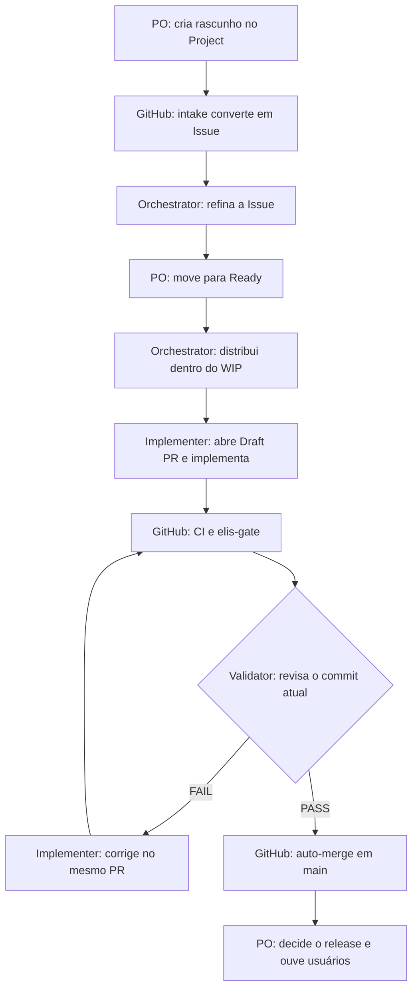

# ELIS — Fluxo Lean de Desenvolvimento e Gestão v1.1

23 de novembro de 2026 · Carlos Rocha

> Tradução de [`docs/process.md`](../process.md). Em caso de divergência, vale o original em inglês.

## 1. O que muda na v1.1

A v1.1 mantém as regras da v1.0 e troca controles que dependiam de disciplina por controles que o GitHub impõe.

| Tema | v1.0 | v1.1 |
| --- | --- | --- |
| Identidades | Segregação "quando possível" | Um GitHub App por agente, com permissões por papel |
| PASS do Validator | Comentário ou check a definir | Review nativo do App do Validator, lido pelo check obrigatório `elis-gate` |
| Classe de risco | Declarada no PR | Calculada pelos caminhos alterados; agentes só elevam |
| Merge | Orchestrator confere uma lista | Auto-merge: o GitHub integra quando os gates passam |
| Limite de WIP | Ausente | 1 Issue por Implementer, 3 PRs em `Review`, 5 itens em `Ready` |
| Gestão do PO | Project como visão geral | Project como única tela de trabalho do PO |
| Novos projetos | Configuração manual | Repositório-modelo e script de bootstrap |
| Idioma | Não definido | UK English; PT-BR opcional em projetos bilíngues |
| Hotfix | "Checks mínimos" | Mesmos gates; reverter por PR primeiro |
| Sem bypass | Absoluto | Exceção auditada, só pelo PO |

### Incorporado da proposta "Kanban determinístico" (Gemini)

A proposta foi validada em 23/11/2026. Sete pontos entram nesta versão e um fica de fora; a seção 12 detalha a extensão para pesquisa.

| Ponto da proposta | Decisão | Onde está |
| --- | --- | --- |
| Estado do quadro vem de gatilhos técnicos, não de atualização manual | Já era a base da v1.1 | Seções 7 e 8 |
| Draft PR aberto no início do trabalho | Adotado | Regra 4, seções 7 e 8 |
| "Ready for review" como gatilho das etapas caras | Adotado | Seção 7 |
| Formulários de Issue, com Issues em branco desabilitadas | Adotado | Seção 6 |
| Campos de reprodutibilidade e teste de regressão por anomalia | Adotado em repositórios de pesquisa | Seção 12 |
| Relatório de avaliação em comentário único, com traces como artefato | Adotado em repositórios de pesquisa | Seções 7 e 12 |
| Registro de resultados negativos | Adotado | Regra 13, seção 10 |
| Limite de WIP por falha de check no PR | Não adotado | Seção 12 |

### Decisões a confirmar pelo PO

- [ ] **Organização no GitHub:** repositórios e Project ficam sob uma organização. É o que permite a um GitHub App acessar o Project.
- [ ] **Plano:** em repositórios privados, o ruleset só é imposto em plano pago (Team, numa organização). Apps não ocupam licença.
- [ ] **Onde os agentes executam:** nos runners do Actions ou na sua máquina, via runner self-hosted. A seção 7 assume os runners do Actions.
- [ ] **Limites de WIP:** os valores 1, 3 e 5 são ponto de partida, a ajustar com o uso.

Os formulários de Issue, o template de PR e o workflow `eval` já estão na pasta do modelo. Os demais arquivos estão especificados aqui e ainda não foram criados. Nada foi testado num repositório. Os comportamentos do GitHub citados vêm de conhecimento da documentação e ainda não foram conferidos em um repositório. O passo 8 da seção 11 confirma os dois pontos antes da adoção.

## 2. Regras centrais (`AGENTS.md`)

Estas treze regras são tudo o que um agente carrega em cada sessão. O texto abaixo é o `AGENTS.md` do repositório-modelo, já em UK English.

```markdown
# Agent rules

1. Every change to `main` goes through a pull request. No direct pushes, no force pushes, no bypass, by anyone.
2. Write everything in UK English: code, comments, commits, branches, Issues, PRs and reviews.
3. Work only on Issues in `Ready`. One Issue per Implementer at a time.
4. One Issue, one branch, one PR. Branch from an up-to-date `main` (`feat/123-short-summary`) and open a draft PR straight away.
5. Keep PRs small. Fix failures in the same branch and the same PR.
6. Act only under your own GitHub App identity. Never use another agent's credentials.
7. Implementers never review. Validators never push code. Nobody validates their own work.
8. A Validator starts from a fresh session, reads the Issue and the diff, and runs the tests itself.
9. A PASS covers one commit. New commits need a new PASS.
10. Never weaken a check, lower a risk class or edit `.github/` to get a PR through.
11. Product questions go to the PO: add `needs-po`, state the question and the options, then move to the next item.
12. No secrets or real personal data in the repository, in logs or in PR text.
13. Record negative results. An experiment that refutes its hypothesis is documented, never silently dropped.
```

O restante deste documento explica como o GitHub impõe cada regra. Os agentes não precisam lê-lo a cada sessão.

## 3. Idioma

Todo conteúdo versionado e todo registro no GitHub é escrito em UK English. Português do Brasil entra como tradução, nunca como original.

| Conteúdo | Regra |
| --- | --- |
| Código, comentários, commits, branches | UK English, sempre |
| Issues, PRs, reviews, labels, campos do Project | UK English, sempre |
| Documentação | Original em `docs/`; tradução opcional em `docs/pt-BR/`, com o mesmo nome de arquivo |
| README | `README.md` em inglês; `README.pt-BR.md` em projetos bilíngues |
| Textos do produto | Arquivos de tradução `en-GB` e `pt-BR`; nenhum texto fixo no código |
| Rascunhos do PO no Project | Qualquer idioma; o Orchestrator redige a Issue em UK English e preserva o original citado |

- **Projeto bilíngue:** é o que tem a pasta `docs/pt-BR/`. O CI confere que cada tradução tem um original em inglês.
- **Divergência:** vale o original em inglês. O PR que altera um documento traduzido atualiza a tradução no mesmo PR.
- **Grafia:** britânica, como `organise`, `behaviour`, `colour` e `licence`. Datas como `23 November 2026` ou `2026-11-23`.
- **Verificação:** `cspell` com dicionário `en-GB` roda no CI sobre documentação, comentários e título do PR.

## 4. Notação dos agentes

Cada agente tem um identificador único no formato `{project}-{role}-{nn}`, por exemplo `elis-imp-01`.

| Parte | Regra | Valores |
| --- | --- | --- |
| `project` | Código do produto, 2 a 4 letras minúsculas | `elis` = ELIS |
| `role` | Papel, 3 letras | `orc` Orchestrator (PM), `imp` Implementer, `val` Validator |
| `nn` | Sequência de dois dígitos por papel | `01`, `02`, … |

O PO é humano e fica fora da notação: age com a própria conta do GitHub. O ELIS começa com `elis-orc-01`, `elis-imp-01`, `elis-imp-02` e `elis-val-01`.

O mesmo identificador aparece em todos os lugares:

| Onde | Forma |
| --- | --- |
| GitHub App | Nome `elis-imp-01`; commits, PRs e reviews aparecem como `elis-imp-01[bot]` |
| Registro no repositório | Entrada em `.github/agents.yml` |
| Worktree local | Pasta `elis-imp-01` |
| Sessão do agente | `elis-imp-01 · #123` |
| Project | Campo de texto `Agent`, preenchido pelo Orchestrator |

Nomes de GitHub App são únicos em todo o GitHub. Se `elis-imp-01` estiver ocupado, o App recebe o prefixo da organização; o identificador do agente não muda.

```yaml
# .github/agents.yml
agents:
  - id: elis-orc-01
    role: orchestrator
    app: elis-orc-01
  - id: elis-imp-01
    role: implementer
    app: elis-imp-01
  - id: elis-imp-02
    role: implementer
    app: elis-imp-02
  - id: elis-val-01
    role: validator
    app: elis-val-01
```

## 5. Identidades: um GitHub App por agente

Cada agente age por um GitHub App próprio, com as permissões do seu papel. A separação entre implementar, validar e integrar passa a ser imposta pelo GitHub.

| Permissão no repositório | `orc` | `imp` | `val` |
| --- | --- | --- | --- |
| Contents | write (merge) | write (branches) | read |
| Pull requests | write | write | write (reviews) |
| Issues | write | write | write |
| Actions e Checks | read | read | read |
| Workflows | nenhuma | nenhuma | nenhuma |
| Administration | nenhuma | nenhuma | nenhuma |
| Projects da organização | write | read | read |

O que essas permissões garantem sem depender do comportamento do agente:

- O Validator não consegue enviar código, porque só lê o conteúdo.
- Nenhum agente altera workflows nem regras de proteção.
- Um App não aprova o próprio PR.
- Todo commit, PR e review fica atribuído a um agente identificável.

### Como o PASS fica infalsificável

O Validator registra PASS ou FAIL como review nativo do PR: "Approve" ou "Request changes". O check obrigatório `elis-gate` só aceita um PASS quando três condições valem:

1. O autor do review está registrado como `validator` no `agents.yml` da branch `main`.
2. O review se refere ao commit atual do PR.
3. O autor do PR está registrado como `implementer`.

Mudar o `agents.yml` ou o próprio `elis-gate` exige um PR em `.github/`. O `CODEOWNERS` atribui essa pasta ao PO, e o ruleset exige a aprovação dele.

### Ruleset da branch `main`

- Pull request obrigatório, com zero aprovações gerais e revisão obrigatória de code owner.
- Checks obrigatórios: `ci` e `elis-gate`, com origem GitHub Actions.
- Histórico linear, merge por squash, conversas resolvidas.
- Force push e exclusão bloqueados.
- Lista de bypass vazia.
- Branch atualizada com a base **não** é exigida; a seção 9 explica.

### Credenciais

- Cada App tem uma chave privada. O agente recebe apenas um token de instalação, válido por uma hora.
- As chaves ficam em segredos de ambientes do Actions: `agent-orc`, `agent-imp` e `agent-val`. Os ambientes aceitam só a branch `main`.
- Jobs que usam chave de App nunca disparam em `pull_request`. Usam `pull_request_target`, `workflow_run`, `issues` ou `schedule`, que leem o workflow da `main`.
- O código do PR roda sem acesso ao token do Validator. Sem isso, um PR malicioso poderia aprovar a si mesmo.

Limite que permanece: a conta do PO administra a organização e pode alterar qualquer regra. A seção 10 trata esse caso como exceção auditada.

## 6. Repositório-modelo

Um repositório `elis-repo-model`, marcado como template na organização, contém tudo o que um projeto novo precisa para nascer com o fluxo ativo.

```text
elis-repo-model/
├─ AGENTS.md                     # the thirteen agent rules (section 2)
├─ README.md
├─ cspell.json                   # en-GB dictionary
├─ docs/
│  ├─ process.md                 # this document, in UK English
│  └─ pt-BR/                     # only in bilingual projects
├─ scripts/
│  └─ bootstrap.ps1              # applies what a template does not copy
└─ .github/
   ├─ CODEOWNERS                 # /.github/ owned by the PO
   ├─ agents.yml                 # agent registry (section 4)
   ├─ risk-paths.yml             # risk class by path (section 9)
   ├─ labels.yml                 # needs-po, needs-refinement, ready, blocked, risk:high
   ├─ PULL_REQUEST_TEMPLATE.md
   ├─ ISSUE_TEMPLATE/
   │  ├─ config.yml              # blank issues disabled
   │  ├─ task.yml
   │  ├─ bug.yml
   │  ├─ research-hypothesis.yml # research repositories only (section 12)
   │  └─ agent-anomaly.yml       # research repositories only (section 12)
   ├─ rulesets/
   │  └─ main.json               # ruleset for main (section 5)
   ├─ scripts/                   # elis-gate.mjs, project-intake.mjs (to be created)
   └─ workflows/                 # section 7; eval.yml exists, the others are to be created
```

### Como replicar em um projeto

1. Criar o repositório pelo botão "Use this template".
2. Rodar `scripts/bootstrap.ps1` com o repositório e o código do produto. Ele aplica o ruleset, cria labels e ambientes, liga o auto-merge e vincula o repositório ao Project.
3. Criar os GitHub Apps do projeto conforme a notação, instalá-los no repositório e guardar as chaves nos ambientes.
4. Preencher `agents.yml`, `risk-paths.yml` e `CODEOWNERS`.
5. Provar os gates com um PR de baixo risco e um FAIL simulado.

O bootstrap existe porque o template copia apenas arquivos. Rulesets, labels, segredos, ambientes, instalações de App e vínculos com o Project não são copiados.

### Como manter os projetos alinhados

A lógica dos workflows fica no modelo, como workflows reutilizáveis. Cada projeto tem apenas chamadas curtas, fixadas em uma tag:

```yaml
# .github/workflows/ci.yml in each project
name: ci
on:
  pull_request:
  push:
    branches: [main]
jobs:
  ci:
    uses: <org>/elis-repo-model/.github/workflows/ci.reusable.yml@v1
```

Uma correção no modelo chega a todos os projetos ao mover a tag `v1`. Por isso o próprio modelo usa o mesmo ruleset, com o PO como code owner.

## 7. Workflows do GitHub Actions

Dez workflows cobrem desenvolvimento, testes, conformidade, acionamento de agentes e gestão. Cinco entram no primeiro dia; os demais, quando houver uso.

| Workflow | Dispara em | O que faz | Entra |
| --- | --- | --- | --- |
| `ci` | PR e push em `main` | Lint, typecheck, build, testes unitários e de integração, `cspell` en-GB e `gitleaks`. Um job final `ci` resume o resultado. | Dia 1 |
| `pr-compliance` | PR aberto ou editado | Confere nome da branch, título em Conventional Commits, Issue vinculada, seções do template e autor registrado. Habilita o auto-merge com squash. | Dia 1 |
| `elis-gate` | PR e review | Calcula o risco pelos caminhos e exige o PASS do Validator no commit atual. | Dia 1 |
| `project-intake` | A cada 15 minutos | Converte rascunhos do Project em Issues e espelha o status `Ready` como label `ready`. | Dia 1 |
| `project-sync` | Eventos de Issue, PR e CI | Move o item: `In Progress` ao abrir o Draft PR, `Review` quando o PR é marcado "ready for review", `Blocked` com a label `blocked`. | Dia 1 |
| `agent-dispatch` | Labels, reviews e resultado do CI | Aciona o agente certo, com a identidade dele, dentro do limite de WIP. | Semana 2 |
| `po-digest` | Semanal e sob demanda | Publica entregas, bloqueios, itens `needs-po` e os indicadores da seção 11. | Semana 2 |
| `e2e` | PR de risco alto; toda noite em `main` | Testes funcionais ponta a ponta, com evidências anexadas ao PR. | No primeiro fluxo crítico |
| `eval` | PR "ready for review" com a label `research`; sob demanda | Roda o benchmark do experimento, mantém um único comentário com métricas contra o baseline e guarda os traces como artefato. Uma execução por vez. | Em repositórios de pesquisa |
| `release` | Tag `v*` ou manual | Publica no ambiente `production` após aprovação do PO. | No primeiro piloto |

### `elis-gate`: o check que decide o merge

```yaml
name: elis-gate
on:
  pull_request:
    types: [opened, synchronize, reopened, labeled, unlabeled]
  pull_request_review:
    types: [submitted, dismissed]
permissions:
  contents: read
  pull-requests: read
jobs:
  elis-gate:
    runs-on: ubuntu-latest
    steps:
      - uses: actions/checkout@v4
        with:
          # rules come from main, never from the PR under review
          ref: ${{ github.event.pull_request.base.sha }}
      - run: node .github/scripts/elis-gate.mjs
        env:
          GH_TOKEN: ${{ github.token }}
          PR_NUMBER: ${{ github.event.pull_request.number }}
```

O script aplica quatro regras, nesta ordem:

1. O autor do PR é um `implementer` registrado; senão, falha.
2. A classe de risco é a mais alta entre os caminhos alterados. A label `risk:high` eleva; nada reduz.
3. Risco baixo passa. Risco médio ou alto exige que o review mais recente de um `validator` registrado seja "Approve" no commit atual.
4. Risco alto exige também o check `e2e` verde no mesmo commit.

### `project-intake`: do rascunho à Issue

```yaml
name: project-intake
on:
  schedule:
    - cron: "*/15 * * * *"
  workflow_dispatch:
permissions: {}
jobs:
  intake:
    # runs in one repository only, so two projects never convert the same draft
    if: github.repository == vars.PORTFOLIO_REPO
    runs-on: ubuntu-latest
    environment: agent-orc
    steps:
      - uses: actions/checkout@v4
      - uses: actions/create-github-app-token@v2
        id: app
        with:
          app-id: ${{ vars.ORC_APP_ID }}
          private-key: ${{ secrets.ORC_PRIVATE_KEY }}
          owner: ${{ github.repository_owner }}
      - run: node .github/scripts/project-intake.mjs
        env:
          GH_TOKEN: ${{ steps.app.outputs.token }}
          PROJECT_NUMBER: ${{ vars.PROJECT_NUMBER }}
```

O script lê o Project pela API GraphQL. Cada rascunho com o campo `Product` preenchido é convertido em Issue no repositório daquele produto, com a label `needs-refinement`. O item do Project é o mesmo antes e depois, sem duplicação. Rascunhos sem `Product` ficam como estão e aparecem no resumo do PO.

### `agent-dispatch`: quem é acionado e quando

| Evento | Agente | Tarefa |
| --- | --- | --- |
| Issue recebe `needs-refinement` | `orc` | Redigir objetivo, critérios de aceite e risco |
| Issue recebe `ready` | `imp` livre | Abrir o Draft PR e implementar |
| PR de risco médio ou alto marcado "ready for review", com CI verde | `val` | Validar o commit atual |
| Review "Request changes" ou CI vermelho | `imp` autor do PR | Corrigir no mesmo PR |

O workflow gera o token do App do agente e inicia a sessão dele no runner, por exemplo com `anthropics/claude-code-action`. Se os agentes executarem na sua máquina, o mesmo workflow roda em um runner self-hosted. Quando o WIP está no limite, o acionamento espera.

### Limites conhecidos

- O GitHub Projects não dispara workflows. Por isso a leitura do quadro é periódica, com atraso de até 15 minutos.
- O `GITHUB_TOKEN` não acessa Projects. Os workflows de Project usam o token do App do Orchestrator.
- Um check obrigatório precisa ser emitido em todo PR. Por isso `ci` e `elis-gate` nunca usam filtro de caminhos no gatilho.
- Etapas que gastam tokens ou tempo (`e2e`, `eval` e Validator) só disparam com o PR fora de draft.

## 8. Gestão pelo GitHub Projects

O PO trabalha em uma única tela, o Project. Issues, PRs e checks continuam sendo a fonte de verdade, atualizados por automação.



O PO cria o rascunho, autoriza com `Ready` e decide o release. Um FAIL volta ao Implementer no mesmo PR, e cada novo commit passa de novo pelo CI e pelo `elis-gate`.

### Configuração do Project

Um único Project na organização reúne todos os produtos, com quatro campos.

| Campo | Valores | Quem altera |
| --- | --- | --- |
| `Status` | `Backlog`, `Ready`, `In Progress`, `Review`, `Done`, `Blocked` | PO até `Ready`; automação depois |
| `Product` | Um valor por produto, como `ELIS` | PO |
| `Priority` | `Now`, `Next`, `Later` | PO |
| `Agent` | Identificador do agente responsável | Orchestrator |

| View | Mostra | Serve para |
| --- | --- | --- |
| Decisions | Itens com a label `needs-po` | Responder perguntas de produto |
| Backlog | `Backlog` e `Ready`, agrupados por `Product`, ordenados por `Priority` | Criar, priorizar e autorizar |
| Board | Todos os itens por `Status` | Ver andamento e bloqueios |
| Done | Concluídos nos últimos 14 dias | Conferir entregas |

Workflows nativos do Project a ligar: adicionar automaticamente Issues e PRs dos repositórios, marcar `Done` ao fechar ou integrar, e arquivar itens concluídos. Se o Project oferecer o workflow nativo "Pull request linked to issue", ele substitui a parte do `project-sync` que marca `In Progress`.

Os limites de coluna do Board ficam ligados como alerta visual: 3 em `Review` e 5 em `Ready`. Eles não bloqueiam nada; quem impõe o WIP é o `agent-dispatch`.

### Fluxo do PO

1. **Capturar.** Na view Backlog, digitar o título na última linha e confirmar. Nasce um rascunho; informar `Product` e `Priority`.
2. **Aguardar a Issue.** Em até 15 minutos o rascunho vira Issue no repositório do produto, no mesmo item. O Orchestrator redige objetivo, critérios de aceite e risco.
3. **Autorizar.** Ler os critérios no painel lateral do item, ajustar se preciso e mudar `Status` para `Ready`. Esse gesto é a autorização de execução.
4. **Decidir.** Abrir a view Decisions e responder no comentário da Issue. O Orchestrator retira a label `needs-po`.
5. **Acompanhar.** O Board mostra o andamento. O resumo semanal chega como comentário na Issue fixada `PO digest`.
6. **Repriorizar ou descartar.** Mudar `Priority`, ou fechar a Issue como "not planned".

Duas ações do PO ficam fora do Project: aprovar um PR que altera `.github/` e aprovar um release. As duas chegam por notificação do GitHub, com link direto.

### Fluxo do PM (Orchestrator)

1. **Refinar.** Preencher o template de cada Issue com `needs-refinement` e dividir as grandes. Dúvida de produto vira `needs-po`.
2. **Cuidar da fila.** Avisar o PO quando `Ready` tiver menos de 2 ou mais de 5 itens.
3. **Distribuir.** Tomar os itens `Ready` por `Priority`, dentro do WIP, e registrar o campo `Agent`.
4. **Desbloquear.** Todo item `Blocked` recebe motivo e responsável em comentário.
5. **Integrar.** Nada manual: o auto-merge integra. O Orchestrator trata conflitos e FAIL repetido.
6. **Informar.** O resumo semanal sai do workflow `po-digest`, sem relatório manual.

O Orchestrator nunca altera `Priority` nem move um item de `Backlog` para `Ready`. Essas duas decisões são do PO.

### Aderência a boas práticas

O fluxo "tarefa no Project gera Issue" atende às boas práticas, com três ajustes já incorporados acima.

- **O que está alinhado:** rascunho é o recurso do Project para capturar ideias. A conversão mantém o mesmo item, e a Issue segue como fonte única do trabalho.
- **Ajuste 1, gatilho:** o Project não dispara Actions. A conversão roda por agendamento, não no instante da criação.
- **Ajuste 2, acesso:** a automação precisa do token de um GitHub App e de um Project pertencente a uma organização.
- **Ajuste 3, conteúdo:** o rascunho não tem template nem labels. Por isso o Orchestrator refina a Issue antes de o PO autorizar.

Existe um caminho sem automação: criar a Issue direto pelo Project, escolhendo o repositório ao adicionar o item. Custa um clique a mais e não tem atraso. Vale como reserva se o `project-intake` falhar.

## 9. Entrega, risco e gates

O risco é calculado pelos caminhos alterados e define os gates. O merge é automático quando todos passam.

| Classe | Caminhos (exemplo) | Gates |
| --- | --- | --- |
| Baixo | `docs/**`, `**/*.md` | `ci` |
| Médio | Código de aplicação; é o padrão para caminho não listado | `ci` e PASS do Validator no commit atual |
| Alto | Autenticação, dados pessoais, memória, ingestão, migrações, `.github/**` | `ci`, PASS e `e2e`; em `.github/**`, também a aprovação do PO |

```yaml
# .github/risk-paths.yml (illustrative paths; adjust per repository)
high:
  - "**/auth/**"
  - "**/migrations/**"
  - "**/ingestion/**"
  - "**/memory/**"
  - ".github/**"
low:
  - "docs/**"
  - "**/*.md"
default: medium
```

- **Classificação:** o `elis-gate` usa a classe mais alta entre os arquivos do PR. Qualquer agente eleva com a label `risk:high`; ninguém reduz.
- **Merge:** o `pr-compliance` habilita o auto-merge com squash. O GitHub integra quando os checks obrigatórios passam.
- **Base desatualizada:** o ruleset não exige branch atualizada, para que um merge alheio não invalide o PASS. O `ci` roda de novo em `main` após cada merge.
- **Fila de merge:** só se a `main` quebrar com frequência por PRs integrados em paralelo.

### Independência do Validator

- Sessão nova, sem o histórico nem o raciocínio do Implementer.
- Parte da Issue e do diff, não da descrição do PR.
- Executa os testes e os critérios de aceite; não apenas lê o código.
- Registra a evidência no review: comandos rodados e resultado observado.

As três decisões da v1.0 continuam separadas: aceite técnico pelo `elis-gate`, integração pelo auto-merge e release pelo PO.

## 10. FAIL, hotfix e exceções

Nenhuma situação reduz gates: o que muda é a prioridade e quem age.

| Situação | Ação | Quem |
| --- | --- | --- |
| Validator dá FAIL | Review "Request changes" com reprodução, esperado × observado e gravidade. Correção no mesmo PR; o novo commit pede novo PASS. | `val`, depois o `imp` autor |
| FAIL repetido sem progresso | Trocar o Implementer, dividir a Issue ou escalar. Não há limite fixo de tentativas. Troca de autor pede outro Validator. | `orc` |
| CI vermelho no PR | Corrigir no PR. Nunca desativar o check. | `imp` autor |
| `main` vermelha após um merge | Reverter por PR primeiro; corrigir depois, em nova Issue. | `orc` aciona um `imp` |
| Hotfix | Branch `hotfix/…`, mesmos gates, prioridade máxima na fila. | `orc` |
| Mudança de escopo | Parar a parte ambígua, marcar `needs-po` e seguir para o próximo item. | Qualquer agente |
| Experimento refuta a hipótese | Registrar o resultado na Issue e na documentação da pesquisa. Fechar o PR sem merge, ou integrar apenas o registro. | `imp` autor; `val` confirma |
| Check ou regra quebrados travam tudo | Exceção auditada. | PO |

### Exceção auditada

Só o PO altera o ruleset, e apenas quando um check ou regra com defeito impede qualquer merge.

1. Abrir uma Issue com a label `process-exception`, o motivo e a regra alterada.
2. Fazer a alteração mínima e integrar a correção por PR.
3. Restaurar a regra e registrar a restauração na mesma Issue.

O resumo semanal lista as exceções abertas e fechadas.

## 11. Implantação e indicadores

A adoção cabe em nove passos, e o fluxo só vale depois do teste do passo 8.

1. Confirmar as quatro decisões da seção 1.
2. Criar a organização, se ainda não existir, e o Project com campos, views e workflows nativos.
3. Criar o `elis-repo-model` com os arquivos da seção 6 e protegê-lo com o próprio ruleset.
4. Criar e instalar os Apps `elis-orc-01`, `elis-imp-01`, `elis-imp-02` e `elis-val-01`; guardar as chaves nos ambientes.
5. Aplicar o modelo ao repositório do ELIS: arquivos por PR, o restante pelo `bootstrap.ps1`. Antes, inventariar os 36 workflows que o repositório já tem em `.github/workflows/` e decidir, para cada um, se é mantido, substituído ou retirado.
6. Ligar os cinco workflows do Dia 1.
7. Criar os arquivos do modelo que ainda faltam, listados na seção 6.
8. Testar quatro casos: PR de baixo risco, PR com FAIL simulado, PR que altera `.github/` e um rascunho no Project. Nenhum pode integrar indevidamente.
9. Ligar `agent-dispatch` e `po-digest`.

### Indicadores

O `po-digest` calcula cinco sinais, sem relatório manual.

| Indicador | Como é medido |
| --- | --- |
| Tempo de ciclo | De `Ready` até o merge |
| Retrabalho | PRs com FAIL e causa principal |
| Qualidade | Reversões e incidentes após merge ou release |
| Espera pelo PO | Tempo de uma Issue com `needs-po` |
| Aprendizado | Hipóteses do MVP testadas e decisões tomadas com usuários |

Commits, PRs e tarefas fechadas não são meta.

## 12. Extensão para repositórios de pesquisa (ELIS)

Repositórios de pesquisa usam o mesmo fluxo, com quatro acréscimos vindos da proposta "Kanban determinístico".

### O que se acrescenta

| Acréscimo | Como funciona |
| --- | --- |
| Formulário `research-hypothesis` | Exige hipótese, dataset e split, métrica com baseline e critério de parada antes de a Issue ir para `Ready` |
| Formulário `agent-anomaly` | Exige amostra, versão do prompt, modelo e seed; a correção inclui um teste de regressão |
| Workflow `eval` | Roda o benchmark quando o PR sai de draft; publica as métricas em um comentário único e guarda os traces por 30 dias |
| Resultados negativos | A hipótese refutada é registrada e o PR é fechado; o aprendizado conta como entrega |

Regras do `eval`:

- **Obrigatório só o que é reprodutível.** Testes de regressão sem chamada a LLM entram no `ci`. O benchmark com LLM varia entre execuções, mesmo com seed; por isso informa, com limiares e tolerância, e não é check obrigatório.
- **Uma avaliação por vez.** O workflow usa `concurrency` para enfileirar execuções. É o limite de WIP 1 da proposta, imposto pelo próprio Actions.
- **Segredos protegidos.** As chaves de LLM ficam no ambiente `eval` do Actions; o job não roda código de PR vindo de fork.
- **Reuso.** O comando do benchmark vem da variável `EVAL_COMMAND` de cada repositório e grava `eval_metrics.json`. No ELIS, ele aponta para o que já existe em `benchmarks/`.
- **Limiares.** Cada métrica pode trazer um limiar no `eval_metrics.json`. O job falha quando uma métrica fica fora dele.

### Estados do quadro

Os seis estados da seção 8 ficam. As duas colunas extras da proposta não entram:

- **Design & Spec:** equivale ao refinamento da Issue, feito em `Backlog` com a label `needs-refinement`.
- **Documentação:** registrar os achados é critério de aceite do próprio PR. Uma coluna depois dos checks e antes do merge não tem gatilho que a mova.

### O que não foi adotado

| Ponto da proposta | Motivo |
| --- | --- |
| `wip-guard` falhando o PR quando a coluna está cheia | Trava trabalho pronto, o que aumenta o WIP. O check não se reavalia quando a vaga abre. O limite fica na entrada, pelo `agent-dispatch` |
| Token pessoal `PROJECT_PAT` | Credencial ampla e ligada a uma pessoa. O acesso ao Project usa o App do Orchestrator |
| Benchmark com LLM como check obrigatório | Resultado não determinístico e pago a cada commit |
| Tabela de métricas e checklist preenchidos à mão no PR | Duplicam o comentário do `eval` e o que o CI já verifica |
| Proteção de branch sem identidades nem validação independente | A v1.1 já cobre com ruleset, Apps e `elis-gate` |
